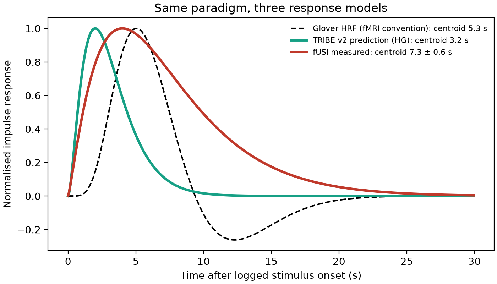
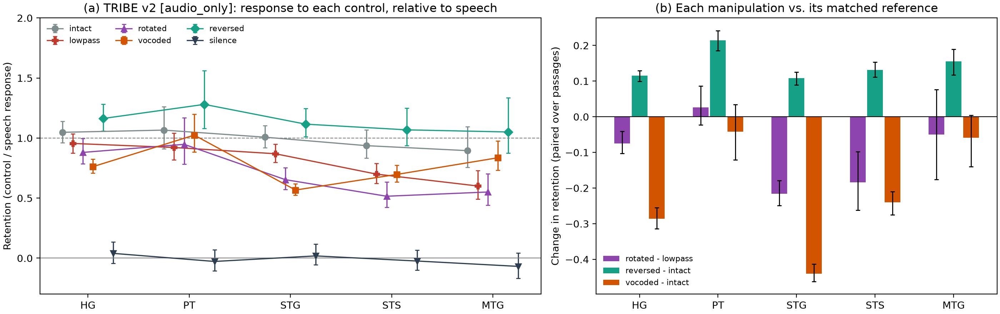
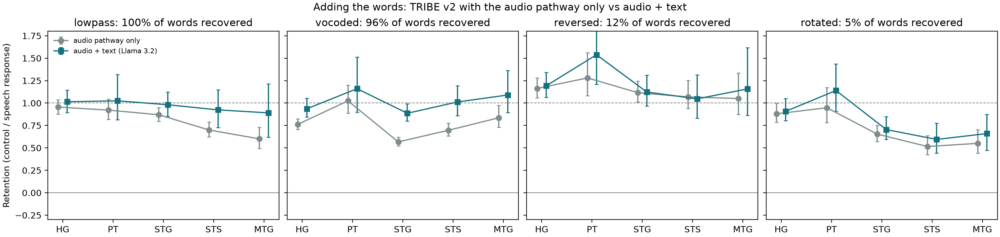
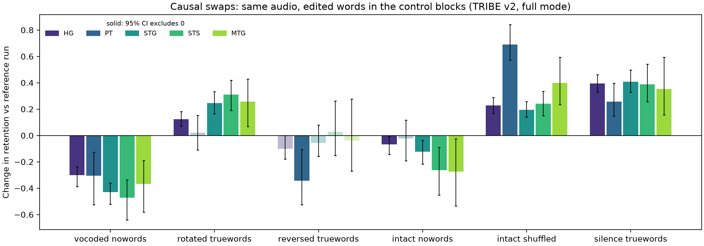
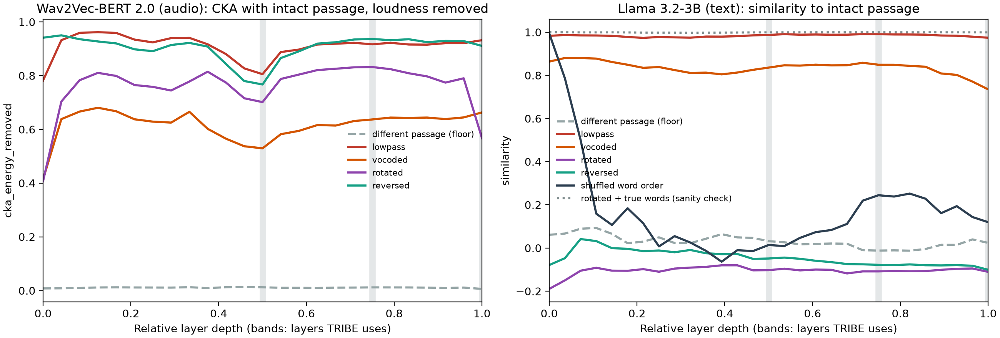
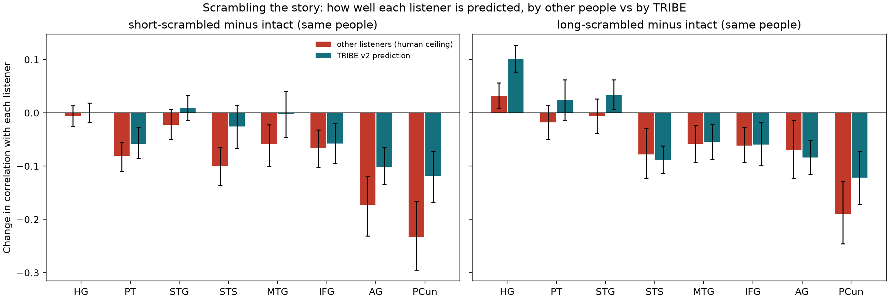

# Speech in ultrasound and in silico

**Does a brain foundation model know what speech is, and does functional ultrasound respond
the way fMRI-trained tools assume?**

This project takes one functional ultrasound (fUSI) recording of auditory cortex during a
speech vs. non-speech block experiment and does two things with it:

1. **Re-analyses the real data** with an open, tested pipeline, and measures the response timing
   from the data instead of assuming the fMRI convention.
2. **Replays the same experiment in silico** through [TRIBE v2](https://github.com/facebookresearch/tribev2),
   Meta's multimodal fMRI encoding model, using synthetic speech and classic acoustic controls
   to ask what the model's "speech areas" actually respond to.

**[Explore the interactive results →](https://claude.ai/artifact/3DKQrjnk1do8h6GyYjMaRN)**
Drag the onset shift to fit the ultrasound signal, compare response shapes, and switch acoustic
controls to see what TRIBE treats as speech.

## Key findings

**1. The fUSI response is later and broader than the fMRI model assumes. The original
pipeline shifted it the wrong way.**
The analysis notebook this project started from shifted every stimulus onset one frame *earlier*
(−1.6 s). Scanning shifts from −6 to +6 s, the standard (Glover) response model fits best at
**+2.8 ± 0.6 s**. Variance explained is 0.53 there, versus 0.35 with no shift and 0.19 with the
original shift. Fitting the response shape directly, its centre of mass falls **7.3 ± 0.6 s**
after the logged onset, against 5.3 s for the fMRI model. Removing the shift raises the peak
z-score for speech from about 9 to **11.2**.

The timing holds on blocks the voxel selection never saw. Choosing voxels from one half of the
blocks and measuring timing only on the other half gives best shifts of **+2.4 to +3.4 s** for
every well-fitting ROI. In all four held-out checks, the original −1 TR shift fits worst of the
three options.

| Voxels chosen on | Timing measured on | Best shift | R² best / no shift / −1 TR |
|---|---|---|---|
| half A (500 voxels) | half B blocks | +3.4 ± 1.4 s | 0.47 / 0.26 / 0.11 |
| half A ∩ half B (262 voxels) | half B blocks | +3.2 ± 1.3 s | 0.51 / 0.26 / 0.09 |
| half A ∩ half B (262 voxels) | half A blocks | +2.4 ± 0.9 s | 0.51 / 0.42 / 0.30 |
| half B (500 voxels) | half A blocks | +5.0 ± 1.6 s | 0.09 / 0.00 / 0.00 |

The half-B ROI fits poorly because the half-B blocks drive weaker responses, even in the half-A
voxels. Its 238 voxels outside the shared set carry a start-of-run transient instead of a block
response (R² 0.23 against 0.52 for the shared voxels). Discarding the first 10 s or selecting
voxels by false-discovery rate instead of a fixed count did not change this.



**2. TRIBE v2's audio pathway responds to how speech sounds, not to whether it is intelligible.**
With the text pathway off, time-reversed speech (unintelligible, but with the same spectrum)
drives every auditory and language region *more* than real speech does (+8 to +21% across two
independent syntheses of the stimuli). Lateral
STG is the region most sensitive to destroying spectral structure: noise vocoding cuts its
response by 44%, and spectral rotation by 22% beyond a bandwidth-matched control.



**3. The right control changed the conclusion.** Spectral rotation seemed to produce a neat
gradient along the auditory hierarchy, with the response falling from primary auditory cortex
to STS. A bandwidth-matched low-pass control showed that most of that gradient comes from
removing energy above 4 kHz, which alone cuts TRIBE's STS and MTG responses by 30–40%. Only
the residual effect, concentrated in STG and STS, is attributable to rotation.

| Region | rotated − lowpass | reversed − intact | vocoded − intact |
|---|---|---|---|
| HG (primary auditory) | −0.07 [−0.10, −0.04] | **+0.12** [+0.10, +0.13] | −0.29 [−0.31, −0.26] |
| PT | +0.03 [−0.02, +0.09] | **+0.21** [+0.19, +0.24] | −0.04 [−0.12, +0.03] |
| STG | **−0.22** [−0.25, −0.18] | **+0.11** [+0.09, +0.13] | **−0.44** [−0.46, −0.41] |
| STS | **−0.18** [−0.26, −0.10] | **+0.13** [+0.11, +0.15] | −0.24 [−0.28, −0.21] |
| MTG | −0.05 [−0.18, +0.08] | **+0.16** [+0.12, +0.19] | −0.06 [−0.14, +0.00] |

*Change in retention (control response as a fraction of the speech response), paired over the
same seven passages; 95% bootstrap intervals over passages.*

**Robustness to the stimulus synthesis.** macOS text-to-speech is not bit-identical between runs,
so the full TRIBE experiment was repeated on a second synthesis of the same passages
(`configs/tts_variant.yaml`). The 15 paired effects correlate at r = 0.995 between the two runs;
every effect keeps its sign, and significance agrees for 14 of 15. The exception is vocoded − intact
in MTG, borderline in both. Tables: [results/robustness_tts_variant/](results/robustness_tts_variant/insilico/audio_only/).

**4. Giving TRIBE the words restores its response to intelligible speech, but does not
penalise unintelligible speech.** In full mode, TRIBE transcribes the audio with WhisperX and
adds Llama 3.2 features of the words. The transcriber recovers 100% of the words from low-passed
speech, 96% from 4-channel vocoded speech, 12% from reversed and 5% from rotated speech. Adding
the words raises retention where the words come through, and barely changes it where they don't:

| Region | lowpass (100% of words) | vocoded (96%) | reversed (12%) | rotated (5%) | intact (null) |
|---|---|---|---|---|---|
| HG | +0.06 [+0.01, +0.13] | **+0.17** [+0.12, +0.25] | +0.03 [−0.03, +0.10] | +0.03 [−0.03, +0.11] | −0.02 |
| STG | +0.11 [+0.04, +0.19] | **+0.32** [+0.26, +0.39] | +0.01 [−0.09, +0.11] | +0.05 [−0.03, +0.16] | −0.00 |
| STS | **+0.22** [+0.06, +0.39] | **+0.32** [+0.20, +0.45] | −0.02 [−0.17, +0.13] | +0.08 [−0.02, +0.22] | +0.04 |
| MTG | **+0.29** [+0.03, +0.54] | **+0.25** [+0.10, +0.40] | +0.11 [−0.10, +0.34] | +0.11 [+0.01, +0.24] | +0.09 |

*Change in retention from audio-only to audio + text mode, paired over passages; 95% bootstrap
intervals.*

With the words, vocoded speech drives STS as strongly as real speech (retention 1.01), and the
low-pass deficit in STS and MTG mostly disappears. Reversed speech still drives STS and MTG at
least as strongly as real speech (1.05 and 1.16). In this model, intelligibility adds to the
response but does not gate it: a human-like "speech area" would respond less to reversed speech.
IFG has no measurable predicted speech response in either mode, so it cannot be assessed here.



**5. Causal swaps confirm that the words drive the restored response, and expose two
places where TRIBE departs from human brains.** TRIBE reads the transcript cached next to each
audio track, so I paired each run's audio with edited words in the control blocks only and
compared it, passage by passage, with the unedited full-mode run:

| Swap (control blocks) | HG | STG | STS | MTG |
|---|---|---|---|---|
| vocoded audio, words removed | **−0.30** | **−0.43** | **−0.47** | **−0.37** |
| rotated audio + the true words | **+0.12** | **+0.25** | **+0.31** | **+0.26** |
| reversed audio + the true words | −0.10 | −0.06 | +0.03 | −0.04 |
| intact audio, words removed | **−0.07** | **−0.12** | **−0.26** | **−0.28** |
| intact audio, words shuffled | **+0.23** | **+0.19** | **+0.24** | **+0.40** |
| silence + the true words | **+0.39** | **+0.41** | **+0.39** | **+0.35** |

*Change in retention against the reference run; bold intervals exclude zero (95% bootstrap over
passages). Full table: [results/insilico/swaps.tsv](results/insilico/swaps.tsv).*

Removing the words from vocoded speech drops its STS retention from 1.01 to 0.54. Giving
rotated speech its true words raises STS retention from 0.59 to 0.91, even though the audio
still cannot be understood. For reversed speech, which already drives these regions as strongly
as real speech, the true words change nothing. In intact speech the words carry part of the
response, more in STS and MTG than in primary auditory cortex.

Two results run against what is known about human cortex. Shuffling the word order *raises* the
predicted response (MTG +0.40), while human language areas respond more strongly to sentences
than to lists of unconnected words (Fedorenko et al., 2010). And words presented with no sound
at all drive every region, including primary auditory cortex (HG retention 0.45). In TRIBE,
the text pathway alone can drive predicted activity in auditory cortex.



**6. Inside TRIBE's encoders: the audio model barely separates reversed speech from real
speech, and the text model separates it completely.** I ran each control passage through the two
open models TRIBE builds on and compared every layer with the same passage spoken intact.
Wav2Vec-BERT 2.0 represents time-reversed speech (flipped back into register) as closely to intact
speech as it represents low-passed speech, at every depth: frame-level CKA 0.89 to 0.94 with each
frame's loudness regressed out, against 0.01 for two different passages. Spectral rotation
separates mainly at the last layer (0.57), and vocoding throughout (0.41 to 0.66). In Llama
3.2-3B, the transcripts of reversed and rotated speech sit at the different-passage floor at every
layer, while vocoded speech stays close (0.74 to 0.88). This is the mechanism behind findings 2
and 5: the audio features TRIBE uses carry reversed speech as if it were speech, and only the
text pathway can tell the difference.

Shuffled word order matches intact speech in the token embeddings (layer 0) and falls to the floor
by about 15% depth, so the text model encodes word order early. TRIBE nevertheless predicts a
*larger* response to shuffled words (finding 5).



**7. On real brains (held out), TRIBE follows the loss of narrative context in most higher
regions, but not in STS and MTG when the story is cut into short pieces.** In the Narratives
dataset (Nastase et al. 2021, CC0), 44 people heard "It's Not the Fall That Gets You" intact and
one temporally scrambled version: sentence-level segments reordered coarsely (22 people) or finely
(22 people). Narratives is not in TRIBE's training data. I ran TRIBE on the real recordings and
compared it with each listener, intact versus scrambled within the same people.

The human data reproduce the known hierarchy: scrambling leaves inter-subject correlation in
Heschl's gyrus almost unchanged (+0.03, a small rise, and −0.01) and lowers it in STS, MTG, IFG, angular gyrus and
precuneus (−0.06 to −0.23). On the intact story, TRIBE correlates with individual listeners at
0.11 to 0.29 and reaches 0.38 to 0.56 of the group-mean noise ceiling, depending on the region.

Change in correlation with each listener, scrambled minus intact (95% bootstrap over people):

| Region | coarse: other listeners | coarse: TRIBE | fine: other listeners | fine: TRIBE |
|---|---|---|---|---|
| HG | +0.03 | **+0.10** | −0.01 | +0.00 |
| STS | −0.08 | −0.09 | **−0.10** | −0.03 (n.s.) |
| MTG | −0.06 | −0.06 | **−0.06** | −0.00 (n.s.) |
| IFG | −0.06 | −0.06 | −0.07 | −0.06 |
| Angular gyrus | −0.07 | −0.08 | **−0.17** | −0.10 |
| Precuneus | **−0.19** | −0.12 | **−0.23** | −0.12 |

With coarse scrambling, TRIBE's fit drops by the same amount as the listeners' shared response in
STS, MTG, IFG and angular gyrus. With fine scrambling, the listeners' shared response in STS and
MTG drops while TRIBE's fit does not change; the differences are significant (STS +0.07, MTG +0.06).
TRIBE's STS and MTG predictions therefore behave like a shorter-timescale region than human STS
and MTG: they keep tracking sentence content after the narrative context that people integrate is
gone. Two cautions: the paper does not state whether people heard the scrambled version before or
after the intact one, and the coarse and fine groups are different people.



## How it works

```
data/ (one fUSI run)                        synthetic speech (macOS TTS)
   │                                                │
   ▼                                                ▼
fusi-glm      QC · censoring · rigid      make-stimuli   same block timing as the fUSI run;
              registration · GLM                         control blocks hold lowpass /
   │                                                     rotated / vocoded / reversed /
   ▼                                                     intact / silence
fusi-timing   timing-agnostic ROI ·                │
              onset-shift scan · gamma fit          ▼
   │                                       run-tribe      TRIBE v2 → 20,484 cortical
   │                                                      vertices × 1 Hz
   │                                                │
   │                                                ▼
   │                                       analyze-tribe  retention per ROI ·
   │                                                      paired contrasts · timing
   └──────────────────────┬─────────────────────────┘
                          ▼
                       report  → results/timing_comparison.png
```

Methods, the full decision log and the limitations are in [docs/methods.md](docs/methods.md).

## Reproduce

```bash
python -m venv .venv && source .venv/bin/activate
make install          # package + TRIBE v2 + pytest
make test             # 46 unit tests, no data needed (~1 min)
make all              # needs the run in data/ (see data/README.md); ~1.5 h on an M-series Mac
```

Or run single steps: `fusi-tribe fusi-glm`, `fusi-tribe fusi-timing`, `fusi-tribe make-stimuli`,
`fusi-tribe run-tribe --mode audio_only`, `fusi-tribe analyze-tribe --mode audio_only`,
`fusi-tribe report`. All settings are in [configs/default.yaml](configs/default.yaml).

Requirements: Python ≥ 3.11. Stimulus synthesis uses macOS `say`. TRIBE v2's audio pathway runs
on CUDA, on Apple Silicon (MPS, with feature extractors on CPU), or on CPU. The full text pathway
needs access to the gated [meta-llama/Llama-3.2-3B](https://huggingface.co/meta-llama/Llama-3.2-3B)
and, in practice, an NVIDIA GPU; the [Colab notebook](notebooks/run_full_mode_colab.ipynb) runs it
on a free T4.

### What the tests check

The tests plant known effects in synthetic data and check that the analysis recovers them:

- an onset shift of −2, 0 or +3 s, recovered by the shift scan
- a gamma response peaking at 8 s, recovered by the grid fit
- a 1 mm translation with anisotropic voxels, recovered by registration (this guards the
  axis-order bug fixed from the original code)
- retention: a silent control gives 0 and a scaled response gives its scale, regardless of
  baseline offset
- the stimuli: rotation maps *f* → 4 kHz − *f*, low-pass and rotation share a band, the vocoder
  keeps the envelope but removes harmonics
- held-out timing: the cross-validation mask drops exactly the selection half's block windows
- transcript placement: each audio chunk gets only its own words, on the global clock (guards
  the tribev2 chunking bug fixed here)

## Limitations

- **One fUSI run.** No claims about other sessions, people or test–retest reliability.
- **Latency vs. clock.** A response that is late relative to logged onsets could reflect slow
  blood-volume dynamics *or* a late event clock. This data cannot separate the two.
- **No spatial comparison.** The fUSI volume is not registered to an atlas, so fUSI and TRIBE
  are compared on timing and selectivity only.
- **Model, not brains.** The TRIBE results describe the model's predictions for one synthetic
  voice and 14 passages. They are hypotheses about cortex, not measurements of it.
- **IFG not testable.** TRIBE predicts essentially no IFG response to these narrative blocks, with
  or without text, so frontal language effects cannot be measured in this design.
- **Original stimuli unavailable.** The in-silico runs reuse the fUSI run's timing with new
  speech; what the real "Audio only" blocks contained is unknown.

## Repository layout

```
src/fusi_tribe/
  fusi/preprocess.py   QC, registration, smoothing, motion regressors
  fusi/glm.py          first-level GLM pipeline
  fusi/timing.py       ROI selection, shift scan, gamma fit, jackknife
  insilico/stimuli.py  speech synthesis and acoustic manipulations
  insilico/tribe.py    TRIBE v2 runner (CUDA / MPS / CPU)
  insilico/analysis.py retention, paired contrasts, TRIBE timing
  insilico/swaps.py    causal swaps: same audio, edited words
  insilico/layers.py   layer-wise separation inside TRIBE's audio and text encoders
  narratives/          held-out test on real fMRI (Narratives, "Not the Fall")
  report.py            cross-modality figures
  cli.py               `fusi-tribe` command
configs/   tests/   docs/   results/ (committed figures and tables)
```

## Data and attribution

The fUSI recording and the original preprocessing helpers (`fusiproc_utils3.py`, adapted in
`fusi/preprocess.py`) were provided as lab sample data and are not redistributed here. TRIBE v2
is © Meta Platforms, Inc. and used under its own licence. The speech passages in
`insilico/passages.py` were written for this project.

## License

MIT for the code written for this project; see [LICENSE](LICENSE). `src/fusi_tribe/fusi/preprocess.py`
adapts lab-provided helper code, and those portions remain subject to whatever terms the original
authors set. TRIBE v2 and its model weights are under their own licences.
